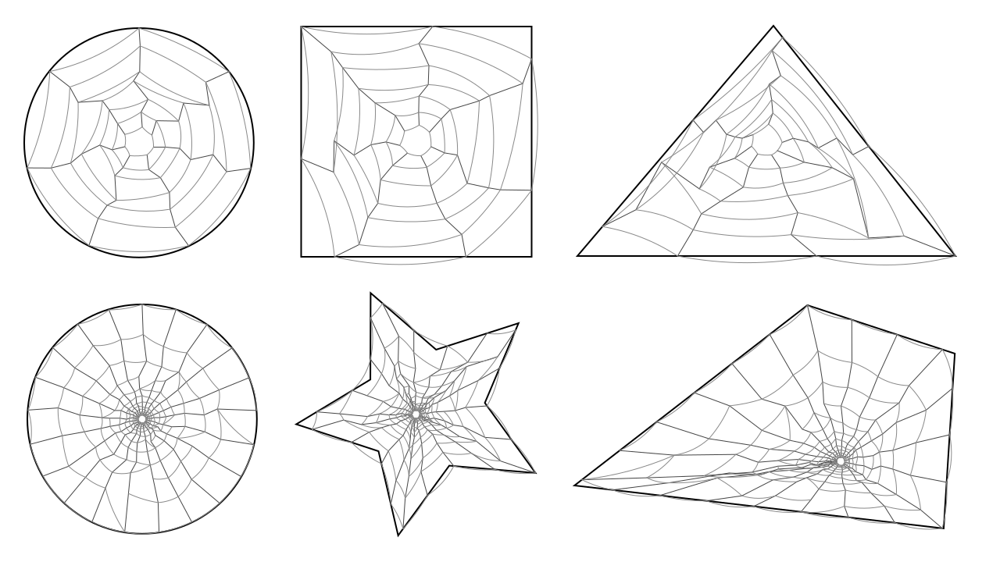
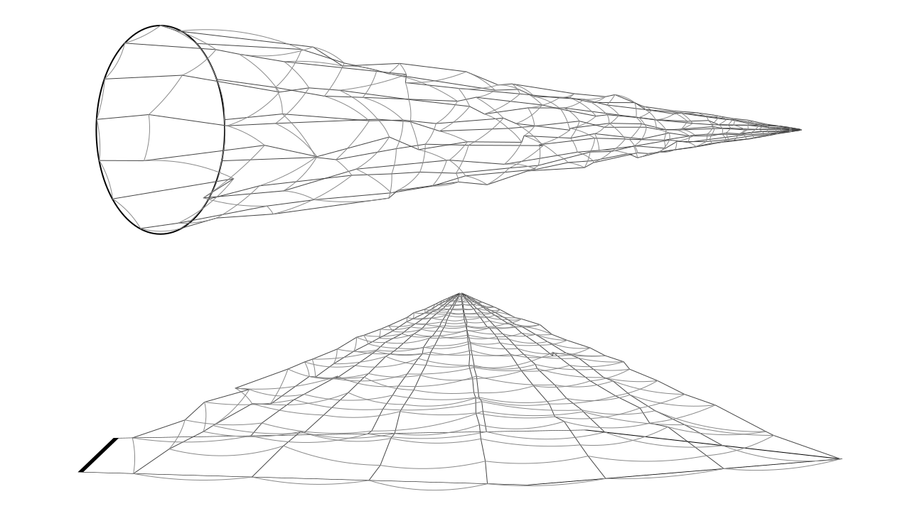
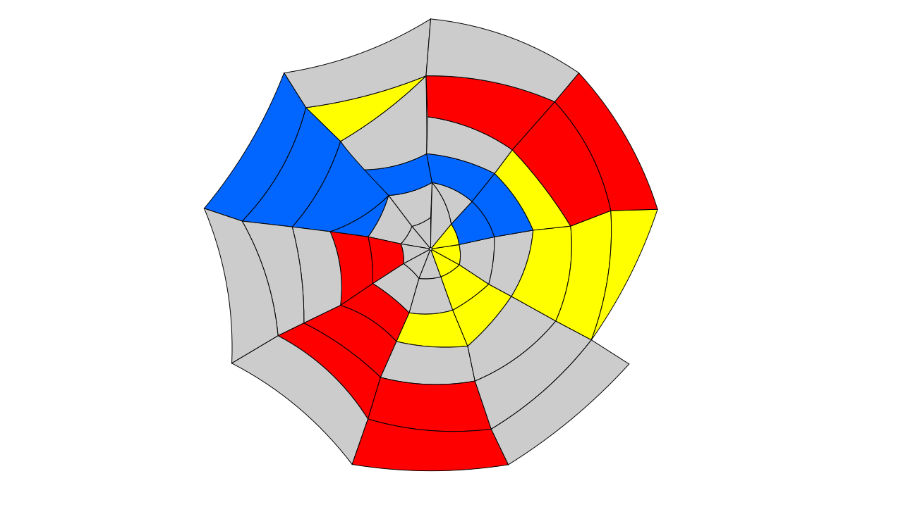

# Inkscape Vector Spider Web

Generate organic, vector spider webs inside any selected path. The selected path acts as the outer boundary; spokes are anchored to boundary points sampled evenly by vertex index along the path, and rings are distributed proportionally along each spoke direction.

**Let's do something crazy, by moving the web center out of boundary.**

**Generate polygons, color them at your choice.**

## Features

- **Path-bounded webs** — use any closed or open path as the web boundary
- **Radial spokes + concentric rings** with sagging Q-curve arcs
- **Noise-driven jitter** — Simplex, FBM, or Turbulence, applied in polar coordinates
- **Adjustable randomness** — angle jitter, radius jitter, sag jitter, seed
- **Web errors** — optional probability of rings snapping to adjacent rings
- **Two output modes** — stroked web (spokes + rings) and/or filled cell polygons
- **Center offset** — nudge the web origin relative to the path bounding box

## Requirements

- Inkscape 1.x

## Installation

1. Copy the folder of this extension into your Inkscape extensions directory:
   - **Linux:** `~/.config/inkscape/extensions/`
   - **macOS:** `~/Library/Application Support/org.inkscape.Inkscape/config/inkscape/extensions/`
   - **Windows:** `%APPDATA%\inkscape\extensions\`

2. Restart Inkscape.

## Usage

1. Draw or select a path to use as the web boundary.
2. Go to **Extensions → Generate from Path → Vector Spider Web**.
3. Adjust parameters and click **Apply**.

### Key parameters

| Parameter | Description |
|---|---|
| Number of radial spokes | How many spokes radiate from the center |
| Number of rings | How many concentric rings are drawn |
| Innermost ring radius | Radius of the first ring |
| Ring spacing growth | 1 = uniform spacing; >1 = wider gaps outward |
| Angle / Radius jitter | Per-vertex noise displacement (0–1) |
| Arc sag | Curvature of ring segments (0 = straight) |
| Spoke curve | Curvature of spoke segments |
| Spoke phase offset | Rotate the starting point of spoke sampling along the boundary (degrees); keeps spokes evenly spaced |
| Noise type / scale | Simplex, FBM, or Turbulence; smaller scale = smoother |
| Random seed | Reproducibility |
| Web error probability | Chance a ring segment snaps to a neighboring ring |
| Center offset X/Y | Shift the web center as % of bounding box |
| Generate mode | `Strokes`, `Polygons` (cells), or `Both` |

## Output

- **Strokes mode:** a group containing spoke and ring paths.
- **Polygons mode:** a group containing closed cell polygons that reuse the exact Q-curve control points of the stroked web.
- **Both:** both groups are created and selected.

## License

MIT